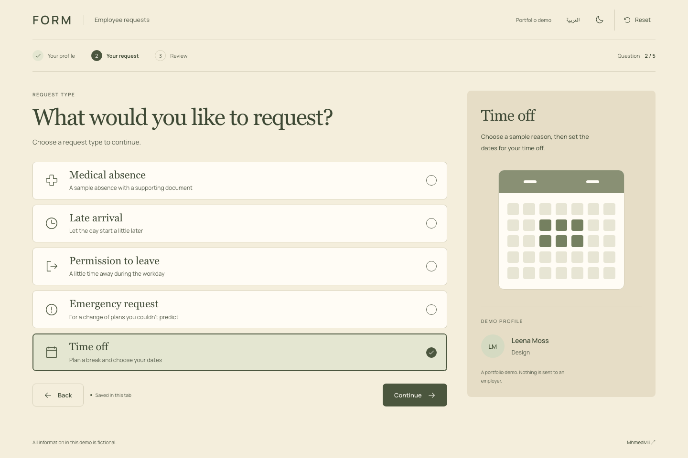

# FORM — Employee Request System | Live Demo Version

**Bilingual Employee Request Management | Software Engineering Portfolio Project**

FORM is a bilingual employee-request application designed to simplify workplace requests through an interactive, step-by-step experience.

Instead of presenting a long traditional form, FORM guides employees through conditional questions based on the selected request type, validates their answers, and generates a simulated request receipt.

**[🌐 View Live Demo](https://form-request-demo.vercel.app/)** · **[💻 View Source Code](https://github.com/MhmedMii/form-request-demo)**

**Tech Stack:** Next.js · React · JavaScript · CSS · Playwright

> **Live Demo Version:** This public application is a portfolio demonstration using entirely fictional employee profiles, reasons, attachments, and receipts. Requests remain in the browser. Email, Google Sheets, Google Drive, and employer notifications are disabled.



---

## 📌 Project Overview

FORM demonstrates a guided employee-request system that makes workplace request submission clearer and easier to follow.

It presents one question at a time and adapts the remaining steps based on the selected request type.

The application supports demonstrations of:

- Medical absence requests.
- Late arrival requests.
- Permission to leave.
- Emergency requests.
- Time-off requests.

Users can review their answers before submission and download a simulated receipt.

The public demo is independent of the original production application and does not collect real employee information.

---

## ✨ Key Features

### Guided Request Workflow

- Step-by-step questions rather than a single lengthy form.
- Conditional questions based on request type.
- Contextual progress indicators.
- Review screen before simulated submission.

### Conditional Input & Validation

- Date selection for time-off requests.
- Generated sample PDF attachment for medical absence.
- Validation against predefined fictional records.
- Request-specific questions and input requirements.

### Bilingual Experience

- English and Arabic support.
- Responsive layouts.
- Light and dark themes.
- Arabic typography using Noto Sans Arabic.

### Simulated Submission & Receipts

- Browser-only demo submissions.
- Generated fictional receipts.
- Downloadable sample documents and receipts.
- Option to reset the demonstration.

### Browser-Based Drafts

Drafts persist within the current browser tab.

The demo can be reset without accessing an external database or service.

---

## 🔄 How It Works

### Employee Request Journey

**Select employee → Choose request type → Answer conditional questions → Review details → Simulate submission → Download receipt**

To explore the workflow:

1. Open the [live demo](https://form-request-demo.vercel.app/).
2. Choose a fictional employee profile.
3. Select a request type and click **Continue**.
4. Choose a sample reason.
5. Complete any additional questions, such as dates or generated sample documents.
6. Review the request details.
7. Select **Submit demo request**.
8. Download the fictional receipt or start another request.

The required questions change according to the selected request type.

No real employee request is submitted during this demonstration.

---

## 👨‍💻 My Contribution

**Role: Software Developer**

The project demonstrates my work on the application's frontend and request-processing workflow, including:

- Building the step-by-step request interface using React and Next.js.
- Organizing request screens into reusable components.
- Implementing conditional question flows.
- Adding validation for supported request scenarios.
- Supporting bilingual content and responsive layouts.
- Implementing browser-based draft persistence.
- Providing simulated submissions and downloadable receipts.
- Maintaining automated checks for business rules and browser workflows.

The publicly available repository contains a demo implementation with production integrations disabled.

---

## 🛠️ Technology & Architecture

| Area                           | Technology            |
| ------------------------------ | --------------------- |
| Application framework          | Next.js               |
| User interface                 | React                 |
| Programming language           | JavaScript            |
| Styling                        | Plain CSS             |
| Icons                          | Phosphor icons        |
| Typography                     | Locally bundled fonts |
| Unit and business-rule testing | Node.js test runner   |
| Browser testing                | Playwright            |

### Design System

FORM uses an **Olive & Cream** visual identity:

- Warm cream backgrounds and muted olive accents.
- Editorial serif headings and clean interface typography.
- A contextual request panel.
- Compact progress indicators.
- Responsive layouts.

Georgia is paired with Manrope for English content, while Noto Sans Arabic supports the Arabic interface.

The FORM identity is text-based and does not include company logos.

### Application Architecture

The application separates request screens, workflow rules, validation, and UI components.

### Workflow Organization

The wizard coordinates application state.

The question-flow logic determines which steps appear based on the selected request type.

Answer components render individual inputs, while validation checks the provided answers against predefined fictional records.

The demo runs locally in the browser without contacting a production backend.

### Separation from Production

The original production application is separate from this public repository.

Its credentials, deployment connections, company imagery, and real employee data have not been included.

The retained Apps Script files are sanitized backend references with setup and entry points disabled.

---

## 📁 Project Structure

```text
form-request-demo/
├── app/                  # Next.js pages, layout, health, and disabled submit API
├── components/
│   ├── wizard/           # Question screens, answers, review, and navigation
│   └── ui/               # Header, progress indicators, and footer
├── lib/                  # Request rules, validation, fixtures, and draft persistence
├── apps-script/          # Sanitized backend reference (disabled)
├── tests/                # Business-rule and service-isolation tests
└── e2e/                  # Playwright browser workflow tests
```

### Architecture Notes

- **Presentation:** React components render the guided request interface.
- **Workflow logic:** Conditional rules determine which question appears next.
- **Validation:** Request-specific requirements are checked using fictional records.
- **Persistence:** Demo drafts are stored in the browser.
- **Backend isolation:** Production integrations are disabled in the public demo.

---

## ▶️ Run Locally

**Requirement:** Node.js 22 or newer.

Clone the repository:

```bash
git clone https://github.com/MhmedMii/form-request-demo.git
cd form-request-demo
```

Install dependencies:

```bash
npm ci
```

Start the development server:

```bash
npm run dev
```

Open the local address displayed by Next.js.

No environment file, Google account, database, or secret is required to run the demo.

---

## 🧪 Testing & Checks

The project includes automated checks for application logic, formatting, demo isolation, and production builds.

Run the available checks:

```bash
npm test
npm run lint
npm run format:check
npm run demo:check
npm run build
```

### Browser Tests

Install Chromium:

```bash
npx playwright install chromium
```

Run Playwright:

```bash
npm run test:e2e
```

These scripts are provided by the repository. Their presence does not independently establish that all checks currently pass.

---

## 🔒 Demo Limitations & Privacy

FORM is a **public live portfolio demonstration**, not a live employee-request service.

The following safeguards and limitations apply:

- Employee profiles are fictional.
- Request reasons and attachments are fictional.
- Downloaded receipts are simulated.
- Real names, contact information, medical files, and free-text personal details are not collected.
- Requests remain in the browser.
- Drafts persist only within the current browser tab.
- Email delivery is disabled.
- Google Sheets and Google Drive connections are disabled.
- Employer notifications are disabled.
- Production submission endpoints are inactive.

This separation allows visitors to explore FORM's interface and request logic without accessing the original production environment.

---

## 👨‍💻 Author

**ENG. Mohammed Mahmoud**  
AI & Software Engineer

- **GitHub:** [@MhmedMii](https://github.com/MhmedMii)
- **Portfolio:** [View Portfolio](https://mohammed-mahmoud-portfolio.vercel.app/)

Built as a portfolio project to demonstrate Next.js, React, and JavaScript development, bilingual Arabic/English interfaces, responsive form layouts, and reusable component design. The live demo showcases conditional request workflows, input validation, browser-based draft persistence, simulated submissions, PDF receipt generation, and automated browser testing with Playwright.
